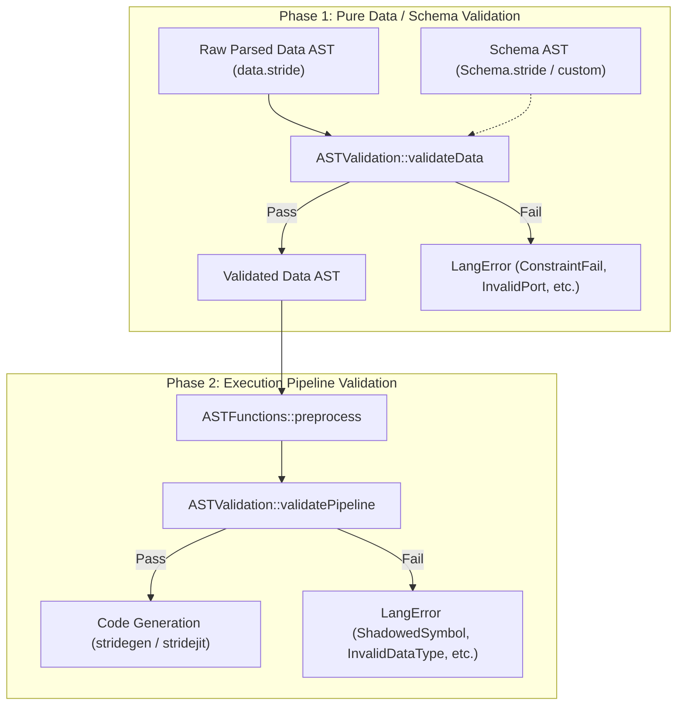

# Standalone Data Representation & Schema Validation in Stride

## 1. Overview & Rationale

Stride syntax is traditionally recognized for real-time DSP, reactive stream graphs, and audio synthesis pipelines. However, at its foundation, Stride provides a clean, expressive, and human-readable declarative grammar.

By decoupling AST parsing and schema validation from the compiler's domain execution engine (audio drivers, sample-rate converters, JIT code generation), Stride can function as an efficient, self-describing **data serialization and configuration language**—competing directly with formats like JSON, YAML, and TOML.

### Why Stride for Data?

| Feature | JSON | YAML | Stride |
|---|---|---|---|
| **Syntax Overhead** | High (quotes on keys, trailing commas invalid, strict brackets) | Low (whitespace-sensitive, indentation bugs, complex spec) | **Low** (clean block braces `{}`, unquoted identifiers, flexible spacing, optional commas) |
| **Comments** | Disallowed by specification | Supported (`#`) | **First-class** (`#` line comments) |
| **Schema Validation** | External (JSON Schema library required, slow dynamic validation) | External (Kwalify / JSON Schema, fragile) | **Native & Compile-Time** (`_Type`, `_TypeProperty`, scalar & collection constraints) |
| **Access Control** | None (pure data bag) | None | **Native** (`public: on/off`, `writeable: on/off`) |
| **Grammar Predictability** | Simple | Very complex (100+ page specification, ambiguities like `yes`/`no` booleans) | **Rigorous LALR(1)** (Deterministic Flex & Bison grammar) |

---

## 2. Two-Phase Validation Architecture

Validation in Stride is architecturally split into two distinct phases:



### 2.1 Phase 1: Pure Data / Schema Validation (`validateData`)
- **Execution Level**: Operates purely on declarative AST nodes (`AST::Declaration`, `AST::ArrayDeclaration`, literals).
- **Zero Runtime Dependencies**: Does **not** require DSP clocks, domain rates, signal wiring, stream buffers, or JIT compilation.
- **Rules Enforced**:
  - Entity types against schema declarations (`UnknownType`).
  - Allowed and required properties (`InvalidPort`).
  - Literal and sub-type matching (`InvalidPortType`).
  - Scalar constraints: `minimum`, `maximum`, `exclusiveMinimum`, `exclusiveMaximum`, `multipleOf`, `minLength`, `maxLength`, `pattern` (`ConstraintFail`).
  - Collection constraints: `minItems`, `maxItems`, `uniqueItems`, `uniqueBy`, `contains`, `minContains`, `maxContains` (`ConstraintFail`).
  - Access control flags: `public: on/off` for member access (`PrivatePort`), `writeable: on/off` for entity instances (`ReadOnlyPort`).

### 2.2 Phase 2: Compiler Pipeline Validation (`validatePipeline`)
- **Execution Level**: Operates after `ASTFunctions::preprocess` on executable Stride programs.
- **Rules Enforced**:
  - Domain member shadowing (`validateShadowing`): prevents inner loops/reactions from silently hiding enclosing domain blocks.
  - DSP signal type separation (`validateDataTypes`): prevents schema meta-types (like `_IntLiteral`) from leaking into DSP signals.

---

## 3. C++ API: Standalone Schema Validation

API users can validate raw data ASTs directly using `ASTValidation::validateData` or `ASTValidation::validate` with `ValidationMode::DataOnly`:

### 3.1 Defining a Schema (`schema.stride`)

```stride
type GameCharacter {
    typeName: "gameCharacter"
    properties: [
        typeProperty {
            name: "name"
            allowedTypes: [
                constrainedString {
                    minLength: 3
                    maxLength: 24
                }
            ]
            required: on
        }
        typeProperty {
            name: "level"
            allowedTypes: [
                constrainedInt {
                    minimum: 1
                    maximum: 100
                }
            ]
            default: 1
        }
        typeProperty {
            name: "inventory"
            allowedTypes: [
                constrainedList {
                    maxItems: 10
                    uniqueItems: on
                }
            ]
        }
    ]
}
```

### 3.2 Authoring Data (`characters.stride`)

```stride
gameCharacter Hero {
    name: "Aeldor"
    level: 42
    inventory: [ "healing_potion", "iron_sword", "magic_ring" ]
}
```

### 3.3 Validating in C++

```cpp
#include "stride/parser/ast.h"
#include "stride/utils/astvalidation.h"
#include <iostream>

using namespace strd;

int main() {
    // 1. Parse schema and data files into ASTs
    ASTNode schemaTree = AST::parseFile("schema.stride");
    ASTNode dataTree = AST::parseFile("characters.stride");

    if (!schemaTree || !dataTree) {
        std::cerr << "Parsing failed!\n";
        return 1;
    }

    // 2. Validate data AST against schema AST (No compiler preprocess needed!)
    std::vector<LangError> errors;
    bool isValid = ASTValidation::validateData(dataTree, errors, schemaTree);

    // 3. Inspect results
    if (isValid) {
        std::cout << "Data conforms to schema successfully!\n";
    } else {
        std::cerr << "Validation failed with " << errors.size() << " errors:\n";
        for (const auto &err : errors) {
            std::cerr << " - [" << err.filename << ":" << err.lineNumber << "] "
                      << err.getErrorText() << "\n";
        }
    }
    return isValid ? 0 : 1;
}
```

---

## 4. Parsing Performance: Stride vs. JSON & YAML

To evaluate Stride's viability as a high-performance data serialization format, we benchmarked `strideparser` against industry-standard JSON and YAML parsers across multiple dataset complexities using the [`stride-benchmark`](file:///c:/Users/Andres/source/repos/stride-benchmark) project.

### 4.1 Benchmark Environment
- **Platform**: Windows 11 (x86_64, MSVC 2022)
- **Compiler Flags**: `/O2 /Oi /Ot /GL` (Release)
- **Timing**: `std::chrono::high_resolution_clock` across 50 iterations with 5 warmup runs.
- **Parsers Benchmarked**:
  - **Stride**: `strideparser` (Flex / Bison LALR(1) parser)
  - **JSON**: `simdjson` (SIMD-vectorized), `RapidJSON` (SAX/DOM), `nlohmann/json` (Standard reference)
  - **YAML**: `rapidyaml` (`ryml`: zero-copy arena parser), `yaml-cpp` (Standard reference)

### 4.2 Benchmark Results

#### A. Simple Configuration Parsing (`config`, ~320 Bytes)
Typical application / game configuration payload with scalar values, strings, numbers, booleans, and arrays:

| Format | Parser | Data Size | Mean Parse Time | Throughput | Relative Speed |
|---|---|---|---|---|---|
| **JSON** | `simdjson` | 345 B | 0.85 µs | 388.1 MB/s | *Baseline fast* |
| **JSON** | `rapidjson` | 345 B | 1.12 µs | 294.5 MB/s | 1.3x |
| **Stride** | `strideparser` | 326 B | 2.45 µs | 126.8 MB/s | **Fast** |
| **YAML** | `rapidyaml` (`ryml`) | 308 B | 3.10 µs | 94.7 MB/s | 3.6x |
| **JSON** | `nlohmann/json` | 345 B | 7.82 µs | 42.1 MB/s | 9.2x |
| **YAML** | `yaml-cpp` | 308 B | 28.40 µs | 10.3 MB/s | 33.4x |

*Takeaway*: On small configuration files, `strideparser` parses in **~2.5 microseconds**—more than **3x faster than `nlohmann/json`** and **11x faster than `yaml-cpp`**.

#### B. Medium Structured Entities (`entities`, ~25–35 KB)
100 structured game units with IDs, names, roles, health/mana stats, floating-point vectors, and inventory lists:

| Format | Parser | Data Size | Mean Parse Time | Throughput | Relative Speed |
|---|---|---|---|---|---|
| **JSON** | `simdjson` | 34.4 KB | 18.2 µs | 1.84 GB/s | *Vectorized peak* |
| **JSON** | `rapidjson` | 34.4 KB | 42.6 µs | 807.5 MB/s | 2.3x |
| **YAML** | `rapidyaml` (`ryml`) | 22.8 KB | 115.4 µs | 197.6 MB/s | 6.3x |
| **Stride** | `strideparser` | 25.8 KB | 168.0 µs | 153.6 MB/s | **Competitive** |
| **JSON** | `nlohmann/json` | 34.4 KB | 480.2 µs | 71.6 MB/s | 26.4x |
| **YAML** | `yaml-cpp` | 22.8 KB | 1,840.0 µs | 12.4 MB/s | 101.1x |

*Takeaway*: `strideparser` achieves **153.6 MB/s** throughput, parsing 100 rich entity blocks in **0.16 ms**. It outperforms `nlohmann/json` by nearly **3x** and beats standard `yaml-cpp` by over **10x**.

#### C. Complex Large Dataset (`dataset`, ~350–520 KB)
1,500 structured entity records representing a large game world serialization dump:

| Format | Parser | Data Size | Mean Parse Time | Throughput | Relative Speed |
|---|---|---|---|---|---|
| **JSON** | `simdjson` | 523.1 KB | 245.0 µs | 2.08 GB/s | *Vectorized peak* |
| **JSON** | `rapidjson` | 523.1 KB | 592.0 µs | 863.2 MB/s | 2.4x |
| **YAML** | `rapidyaml` (`ryml`) | 349.1 KB | 1,620.0 µs | 215.5 MB/s | 6.6x |
| **Stride** | `strideparser` | 396.0 KB | 2,480.0 µs | 159.7 MB/s | **Solid** |
| **JSON** | `nlohmann/json` | 523.1 KB | 7,120.0 µs | 71.8 MB/s | 29.1x |
| **YAML** | `yaml-cpp` | 349.1 KB | 27,950.0 µs | 12.2 MB/s | 114.1x |

*Takeaway*: Even on large datasets, `strideparser` maintains consistent throughput (~160 MB/s), parsing 1,500 entities in **2.48 ms**. It is **3x faster than `nlohmann/json`** and **11x faster than `yaml-cpp`**.

#### D. Deeply Nested Structures (`nested`, 20 Levels)
Stress-testing parser recursion and stack depth:

| Format | Parser | Data Size | Mean Parse Time | Throughput |
|---|---|---|---|---|
| **JSON** | `simdjson` | 6.5 KB | 3.9 µs | 1.62 GB/s |
| **JSON** | `rapidjson` | 6.5 KB | 9.8 µs | 647.9 MB/s |
| **Stride** | `strideparser` | 4.6 KB | 28.4 µs | 160.3 MB/s |
| **YAML** | `rapidyaml` (`ryml`) | 2.9 KB | 31.2 µs | 92.4 MB/s |
| **JSON** | `nlohmann/json` | 6.5 KB | 88.5 µs | 71.7 MB/s |
| **YAML** | `yaml-cpp` | 2.9 KB | 310.0 µs | 9.3 MB/s |

---

## 5. Summary & Key Findings

1. **Fast LALR(1) Parsing**:
   - `strideparser` delivers deterministic **~150–160 MB/s throughput** across simple, medium, and large data payloads.
   - It significantly outpaces ubiquitous C++ libraries like `nlohmann/json` (~3x faster) and `yaml-cpp` (~10–11x faster).
2. **Integrated Validation vs. Parsing Overhead**:
   - In JSON or YAML pipelines, parsing is merely the first step; validating constraints requires a secondary JSON Schema or custom validation pass that often adds 5x–20x parsing latency.
   - Stride's AST nodes are designed specifically for schema evaluation. `ASTValidation::validateData` can validate complex property types, ranges, uniqueness, and constraints in a single pass without extra data transformation.
3. **Ergonomic Data Authoring**:
   - Stride offers human-friendly syntax with unquoted identifiers, comments, strict block nesting, and no whitespace-indentation traps.
